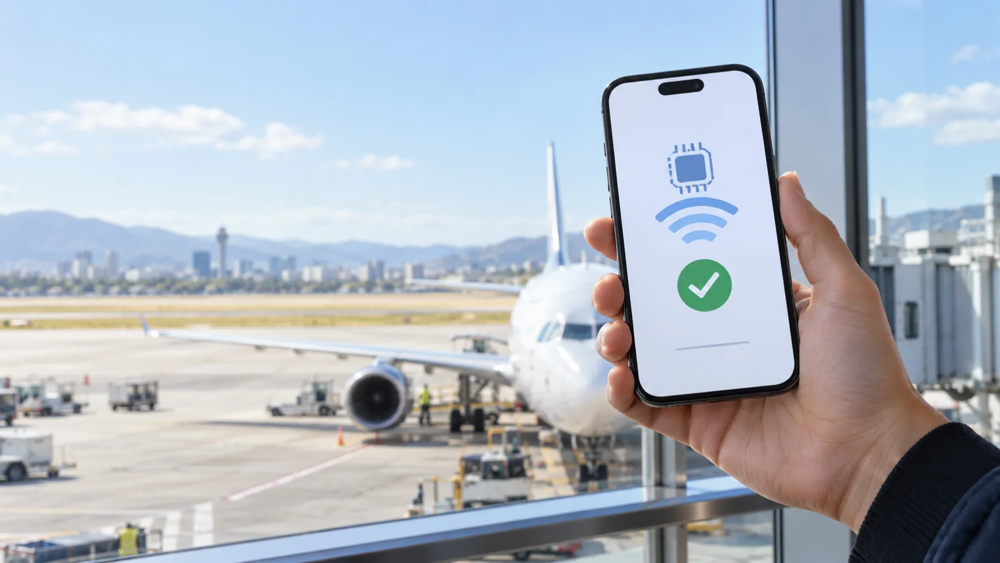

# eSIM Free Trial

Get a real **1 GB travel data eSIM free for 3 days** with the uPhone eSIM Free Trial. Choose from 100+ countries, install the eSIM on your own iPhone or Android phone, and test it on a live mobile network before committing to a full plan.

[**Claim the eSIM Free Trial**](https://uphone.com/try-esim-free?ref=CHRISYAU&sub1=github-esim-free-trial&utm_source=github&utm_medium=referral&utm_campaign=free-esim-trial)

> **Affiliate disclosure:** The link above is an affiliate link. We may earn a commission after an eligible paid conversion, at no extra cost to you.



---

## eSIM Free Trial at a glance

- **Trial data:** One real data eSIM with up to 1 GB
- **Destinations:** 100+ eligible countries
- **Trial period:** $0 for the first 3 days
- **After the trial:** $9.99/month unless cancelled before day 3
- **Monthly value:** Each paid renewal becomes $9.99 of uPhone account credit, valid for 30 days
- **Card check:** A temporary $1 authorization is reversed immediately; your bank may take several days to remove the pending hold
- **Plan type:** Data only; the trial does not include a phone number
- **Cancellation:** Cancel within 3 days to pay nothing; cancelling deactivates the trial eSIM

Always review the current offer and eligibility terms on uPhone before activating.

---

## How to get the eSIM Free Trial

### 1. Open the tracked uPhone offer

Use the English eSIM Free Trial link below. It includes the approved `CHRISYAU` affiliate code and campaign tags for this GitHub guide.

[Open the uPhone eSIM Free Trial](https://uphone.com/try-esim-free?ref=CHRISYAU&sub1=github-esim-free-trial&utm_source=github&utm_medium=referral&utm_campaign=free-esim-trial)

### 2. Create or sign in to your account

Continue with Google, Microsoft, or email. Use an email address you can access because your account and eSIM details are managed through uPhone.

### 3. Complete the card verification

Add a valid card. uPhone places and immediately reverses a temporary **$1 authorization**. This is not a fee, although the pending hold may remain visible until your bank removes it.

### 4. Choose your test destination

Select an eligible country from the 100+ available destinations and claim the free test eSIM. The trial includes one real data eSIM with up to 1 GB.

### 5. Install the eSIM on Wi-Fi

Use the QR code or manual installation details shown in your uPhone dashboard. Install the eSIM while connected to stable Wi-Fi. Do not delete it after installation because many eSIM activation codes can be used only once.

### 6. Test the connection

Label the new line `Travel`, select it for mobile data, and follow uPhone's data-roaming instructions. If you do not want the membership to continue, cancel before the end of day 3.

---

## Before you start

You will need:

- An eSIM-compatible phone
- An unlocked device that can use another carrier
- Stable Wi-Fi for installation
- Access to your email and uPhone account
- A valid card for the temporary $1 authorization

Recent iPhone, Google Pixel, Samsung Galaxy, and many other phones support eSIM. Carrier restrictions and regional device variants can affect support, so check your exact model before claiming the trial.

---

## Install the trial eSIM

Menu names can vary slightly by phone model and software version.

### iPhone

```text
Settings > Cellular / Mobile Service > Add eSIM
```

1. Choose **Use QR Code** or uPhone's direct-install option.
2. Label the new line `Travel`.
3. Keep your primary line selected for calls and texts unless you want to change it.
4. Select the travel eSIM for cellular data when you are ready to test it.

### Google Pixel

```text
Settings > Network & internet > SIMs > Add SIM
```

1. Choose **Set up an eSIM**.
2. Scan the QR code supplied by uPhone.
3. Give the new SIM a clear travel label.
4. Select it for mobile data and follow uPhone's roaming instructions.

### Samsung Galaxy

```text
Settings > Connections > SIM manager > Add eSIM
```

1. Choose **Scan QR code from service provider**.
2. Finish the download while connected to Wi-Fi.
3. Select the new plan for mobile data in SIM manager.
4. Follow uPhone's roaming instructions when testing the line.

---

## Troubleshooting

| Problem | What to check |
| --- | --- |
| No signal | Confirm that the eSIM is turned on and selected for mobile data. Toggle airplane mode for 30 seconds, then restart the phone. |
| Installed but no data | Check uPhone's activation timing, APN, and data-roaming instructions. Turn off cellular data switching while testing. |
| QR code will not scan | Increase the brightness of the screen showing the QR code, clean the camera lens, or use the manual activation details. |
| Code already used | Do not delete an installed eSIM unless uPhone confirms it can be reissued. Many QR codes install only once. |
| Trial eSIM stopped working | Check whether the 3-day trial ended or the Test Flight membership was cancelled. Cancellation deactivates the test eSIM. |

---

## Frequently asked questions

### Is the eSIM Free Trial really free?

The first 3 days are $0. A valid card is required for a temporary $1 authorization, which uPhone reverses. If you do not cancel before the end of day 3, Test Flight continues at $9.99/month.

### What happens after the 3-day trial?

The Test Flight membership automatically renews at $9.99/month unless cancelled. Each paid renewal adds $9.99 in uPhone account credit that is valid for 30 days and can be spent on an eligible eSIM plan.

### What if I cancel within 3 days?

You pay nothing. The free test eSIM is deactivated immediately when the membership is cancelled.

### Does the free eSIM include a phone number?

No. It is a data-only eSIM. Your regular number remains on your primary SIM, while apps such as WhatsApp, FaceTime, and iMessage can use the eSIM data connection.

### Will installing an eSIM remove my regular SIM?

No. Installing an eSIM adds another mobile plan. On a dual-SIM phone, you can keep your primary line available for calls and texts while using the travel eSIM for data.

### Should I install it before travelling?

Install it on reliable Wi-Fi before you need the connection. Remember that this offer is a three-day membership trial, so claim it close enough to your test or travel date to use it during the trial window.

---

## Claim the eSIM Free Trial

[**Get the uPhone eSIM Free Trial**](https://uphone.com/try-esim-free?ref=CHRISYAU&sub1=github-esim-free-trial&utm_source=github&utm_medium=referral&utm_campaign=free-esim-trial)

The tracked URL uses:

```text
Affiliate: CHRISYAU
Source: github
Campaign: free-esim-trial
```

Offer availability, supported destinations, data allowance, and membership terms can change. Confirm the current details on the uPhone website before signing up.

---

## Live one-page guide

The same guide is also available as a responsive one-page website:

<https://chrisyau83.github.io/esim-free-trial/>

## License

The site code is available under the [MIT License](LICENSE). The generated hero image is included for use with this project.
